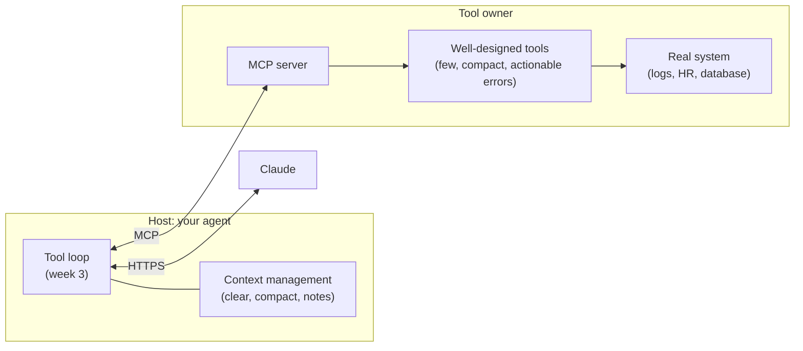
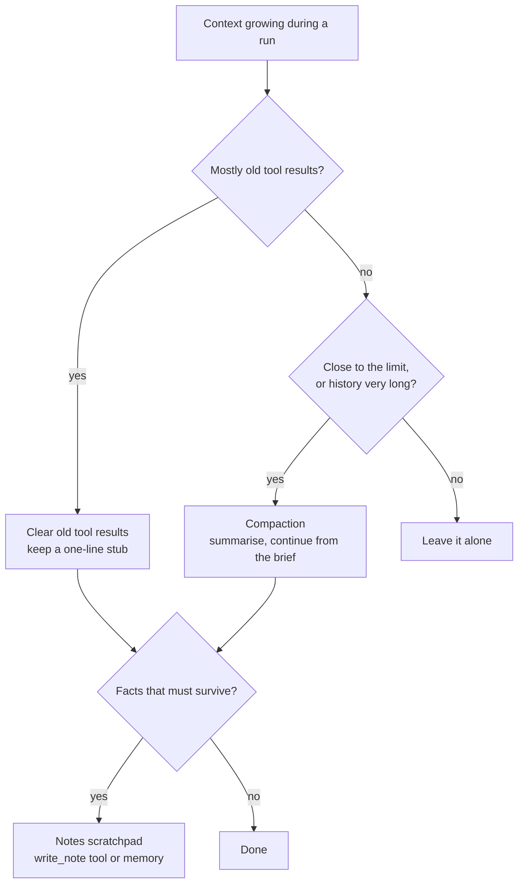
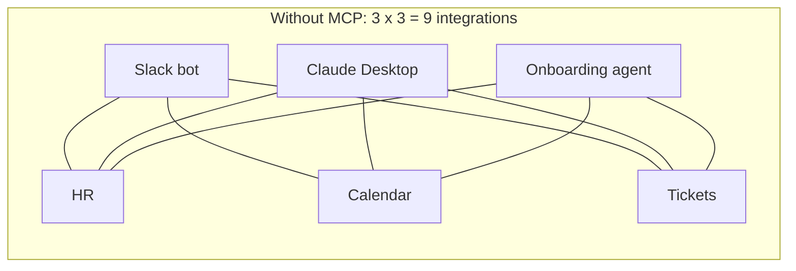
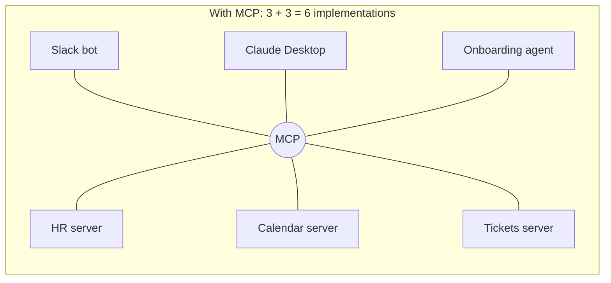
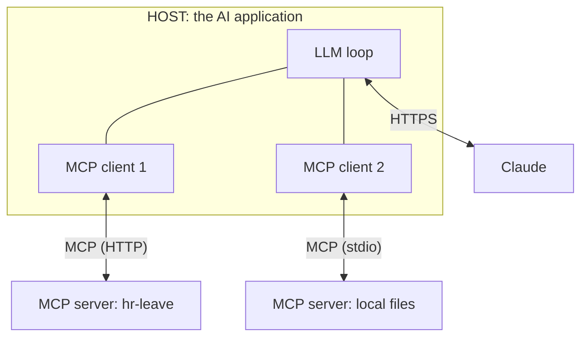
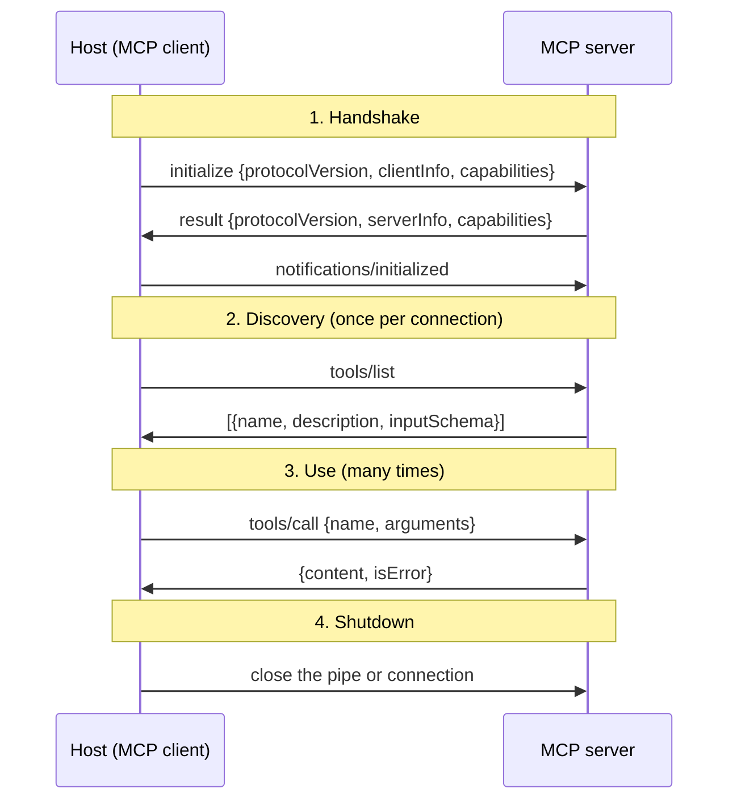
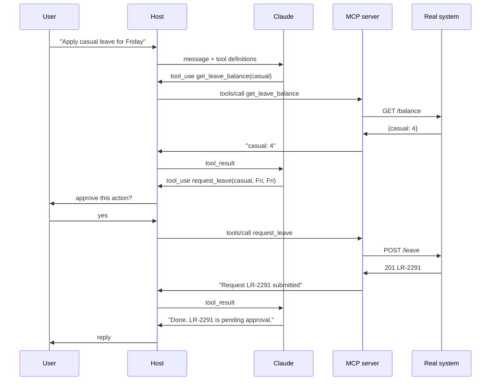
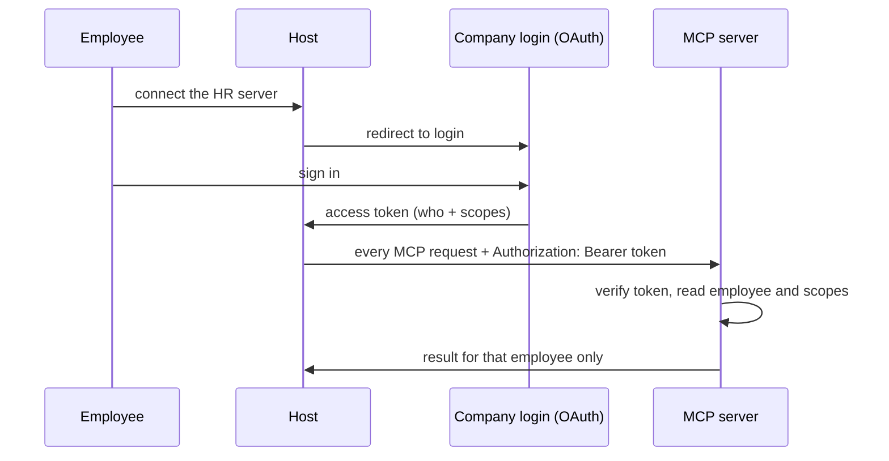
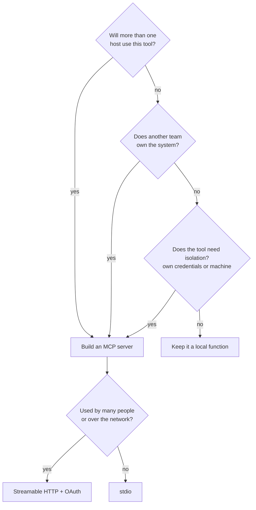
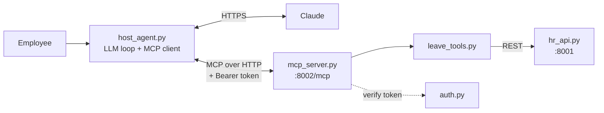

<!-- markdownlint-disable MD001 -->
<!-- markdownlint-disable MD024 -->
<!-- markdownlint-disable MD025 -->
<!-- markdownlint-disable MD026 -->
<!-- markdownlint-disable MD029 -->
<!-- markdownlint-disable MD033 -->
<!-- markdownlint-disable MD040 -->
<!-- markdownlint-disable MD056 -->
<!-- markdownlint-disable MD060 -->

# Week 4: Tool design, context management, and MCP

---

## Contents

01. [The week in one page](#1-the-week-in-one-page)
02. [Tool design](#2-tool-design)
03. [Context management on long runs](#3-context-management-on-long-runs)
04. [MCP: the Model Context Protocol](#4-mcp-the-model-context-protocol)
05. [MCP vs local function vs the MCP connector](#5-mcp-vs-local-function-vs-the-mcp-connector)
06. [Worked example: the HR leave system](#6-worked-example-the-hr-leave-system)
07. [Use cases](#7-use-cases)
08. [Relevance: why this week matters](#8-relevance-why-this-week-matters)
09. [Common mistakes](#9-common-mistakes)
10. [Cheat sheet](#10-cheat-sheet)
11. [20 interview questions and answers](#11-20-interview-questions-and-answers)
12. [Glossary](#12-glossary)

---

## 1. The week in one page

Week 3 gave you a working tool loop: Claude asks for a tool, your code runs it, the result goes back, repeat.  
Week 4 answers the three questions that appear the moment that loop meets real work.

| Question                                            | Topic              | One-line answer                                                                 |
|-----------------------------------------------------|--------------------|---------------------------------------------------------------------------------|
| Why does the model keep misusing my tools?          | Tool design        | The model only sees name, description, inputs and outputs. Design those for it. |
| Why do long runs get slow, expensive and forgetful? | Context management | History is re-sent every turn. Remove what is no longer needed.                 |
| How do other apps and teams reuse my tools?         | MCP                | Move tools into a separate server that speaks a standard protocol.              |

How the three fit together:



- **Tool design** decides the quality of what sits behind the server.
- **Context management** decides how long the host can keep going.
- **MCP** decides how the host and the tools find and talk to each other.

MCP gets the most attention because it is new vocabulary, but the other two decide whether an agent actually works.  
An agent with badly designed tools behind a perfect MCP server still fails.

---

## 2. Tool design

### 2.1 The problem

A human developer reads docs, looks at source code, and asks a colleague.  
The model has none of that. For each tool it sees exactly four things:

1. the **name**
2. the **description**
3. the **input schema**
4. the **text that comes back** when it calls the tool

Everything it knows about your system comes through those four.  
A tool written for a programmer (raw JSON out, numeric error codes, twenty optional flags) forces the model to guess, and every wrong guess costs a full round trip.

### 2.2 The four rules

**Rule 1: fewer, higher-level tools.**
Wrap a whole task, not one API endpoint. Each extra tool is another choice the model can get wrong, and each extra step is another full request.

| Low-level (avoid)                           | High-level (prefer)                     | Why it is better                                   |
|---------------------------------------------|-----------------------------------------|----------------------------------------------------|
| `list_files`, `read_file`, `grep`           | `search_logs(service, pattern, since)`  | One call instead of three or more                  |
| `list_users`, `list_events`, `create_event` | `schedule_meeting(attendees, duration)` | The tool handles the lookup the model would fumble |
| `get_customer`, `get_orders`, `get_tickets` | `get_customer_context(customer_id)`     | Returns exactly what the task needs, pre-joined    |

**Rule 2: actionable errors.**
An error message is a prompt for the next attempt. Say what went wrong and what to do about it.

| Bad                    | Good                                                                                            |
|------------------------|-------------------------------------------------------------------------------------------------|
| `Error: 404`           | `Unknown service 'checkout-svc'. Valid: checkout, payments, search.`                            |
| `Invalid input`        | `start_date '14/11/2026' is not a valid date. Use YYYY-MM-DD, e.g. 2026-11-14.`                 |
| `Insufficient balance` | `Not enough casual leave: requested 3, available 1. Call get_leave_balance to see other types.` |

With a good error the model fixes its call on the next turn.  
With a bad one it retries the same thing, guesses, or gives up and tells the user something vague.

Zero results is not an error. `No lines matching 'timeout' in checkout.` is a valid, useful answer.  
Mark only real failures as errors (`is_error: true` in the Messages API, `isError` in MCP).

**Rule 3: compact output.**
Whatever a tool returns stays in the conversation and is re-sent on every later turn. Return what helps the next decision and nothing else.

- Prefer readable text or trimmed JSON over a raw API dump.
- Drop internal ids, trace ids, and fields the model never uses.
- Prefer names over opaque ids where possible (`checkout` over `svc_8f3a2c`).
- Keep a pointer (file, time range, request id) so the detail can be fetched again if needed.

**Rule 4: pagination and truncation, stated out loud.**
A tool that can return 4,000 lines must not return 4,000 lines.

```
09:07:01 ERROR db pool exhausted (5/5 in use)
09:07:02 ERROR POST /checkout 503
...
[4,000 matches, showing 1-50. Narrow with 'pattern' or pass page=2.]
```

The footer does two jobs: it tells the model the result was cut, and it teaches the model how to get a better result.  
Silent truncation is the worst case, because the model reasons as if it saw everything.

### 2.3 Anatomy of a good tool

```python
@mcp.tool()
def request_leave(leave_type: Literal["casual", "sick", "earned"],
                  start_date: str, end_date: str, reason: str = "") -> str:
    """Submit a leave request for the signed-in employee. Dates are YYYY-MM-DD, inclusive.
    Call get_leave_balance first. The request goes to the manager for approval."""
```

| Part          | What this example does                                   | Why                                                        |
|---------------|----------------------------------------------------------|------------------------------------------------------------|
| Name          | Verb plus object: `request_leave`                        | The model picks tools mostly by name                       |
| Description   | What it does, input format, when to use it, what happens | It is a prompt. It is the only documentation the model has |
| Inputs        | `Literal[...]` becomes an `enum` in the schema           | The model cannot invent a fourth leave type                |
| Missing input | No `employee_id`                                         | Identity comes from the login, never from the model        |
| Output        | One readable sentence with the request id                | Compact, and the model can quote it to the user            |
| Errors        | Text that names the fix                                  | The model can recover without the user                     |

### 2.4 The description is a prompt

When the model misuses a tool, the first fix is almost never code. Check, in this order:

1. **Name.** Is it clear what the tool does compared with its neighbours? `search` next to `find` next to `query` is a coin toss.
2. **Description.** Does it say *when* to use the tool and when not to?
3. **Schema.** Can constraints move from prose into the schema (`enum`, required fields)?
4. **Output.** Did the previous result mislead the model?

Then verify by reading transcripts. Tool design is empirical: you watch real runs, find where the model stumbles, and change the tool.

### 2.5 Cautions

- **Over-merging.** One `do_everything(action, params)` tool is as bad as thirty tiny ones. One tool, one clear job.
- **Truncation can hide the root cause.** If line 51 held the answer, a 50-line cap hides it. Always state the cut and offer a way to narrow.
- **Write tools need guard rails.** Validate everything server-side. A schema stops a wrong type, not a wrong decision.
- **Too many tools.** Every tool definition is sent with every request. Dozens of tools cost tokens and blur the choice. Load only what the task needs.

---

## 3. Context management on long runs

### 3.1 The problem

The Messages API is stateless. Every request carries the full conversation so far.  
In an agent loop, each step appends a tool call and its result, so the input grows with every step and the total cost grows much faster than the step count.

Three things go wrong as context grows:

| Symptom        | Cause                                                                                   |
|----------------|-----------------------------------------------------------------------------------------|
| Cost climbs    | Every old tool result is paid for again on every later turn                             |
| Latency climbs | More input tokens to process per call                                                   |
| Quality drops  | Important facts get buried in stale output, and the model attends to them less reliably |

### 3.2 Worked numbers

Assume an investigation of 15 steps. The base prompt (system, tools, question) is 2,000 tokens and each tool result is 3,000 tokens.  
Ignore the small assistant messages.

**Without management:** step *n* sends `2,000 + 3,000 x (n - 1)` input tokens.

**With clearing:** keep the last 2 tool results in full and replace older ones with a 30-token one-liner.

| Step      | Input tokens, no management | Input tokens, clear all but last 2 |
|-----------|-----------------------------|------------------------------------|
| 1         | 2,000                       | 2,000                              |
| 2         | 5,000                       | 5,000                              |
| 3         | 8,000                       | 8,000                              |
| 5         | 14,000                      | 8,060                              |
| 10        | 29,000                      | 8,210                              |
| 15        | 44,000                      | 8,360                              |
| **Total** | **345,000**                 | **113,340**                        |

That is a 67% cut in input tokens for the run, and the per-step input stays flat instead of climbing.  
The plan's week-4 target of "tokens per investigation down 30% or more" is easy to hit with this one technique.

Caveat: the comparison ignores prompt caching.  
With caching, re-sent history is billed at a small fraction of the normal price, which shrinks the cost gap.  
Clearing still helps latency and quality, but see 3.5 before combining the two.

### 3.3 The techniques



**Technique 1: clear old tool results (cheapest).**
Once the model has used a result, replace its body with one line:

```text
[cleared] search_logs checkout 09:00-09:15: 212 lines. First error: 09:07 db pool exhausted.
```

Keep the `tool_use` and `tool_result` pair so the conversation structure stays valid.  
Only the body changes. Trigger it past a token threshold, not on every turn.

**Technique 2: compaction.**
When the history itself is long, summarise everything so far into a short brief and continue from that brief plus the most recent turns.  
Stronger than clearing, but lossy: a summary can drop the one detail that mattered.

**Technique 3: notes scratchpad.**
Give the agent a `write_note` tool. It records findings as it goes ("deploy d-41 at 09:05 changed pool size 50 to 5").  
Notes live outside the message history, so they survive both clearing and compaction.  
The host re-injects them when needed.

**Technique 4: do not load it in the first place.**
The best token is the one never added. Compact tool output (section 2), search instead of dumping, and fetch details only when the model asks for them.

**Technique 5: sub-agents (later weeks).**
Hand a noisy sub-task to a separate agent with its own context.  
It reads 50,000 tokens of logs and returns a 300-token conclusion.  
The main agent's context only grows by the conclusion.

### 3.4 What Claude's API gives you

| Feature         | What it does                                                | How you turn it on                                                                   |
|-----------------|-------------------------------------------------------------|--------------------------------------------------------------------------------------|
| Context editing | Server clears old tool results (or thinking blocks) for you | Beta. `context_management.edits` with a strategy such as `clear_tool_uses_20250919`  |
| Compaction      | Server summarises earlier context near a trigger threshold  | Beta. Append the full `response.content` back each turn so compaction blocks survive |
| Memory tool     | A file-like store the model reads and writes across the run | Tool type `memory_20250818`. You implement the storage                               |
| Prompt caching  | Re-sent prefix billed at a fraction of the price            | `cache_control` breakpoints. Not a context reducer, a cost reducer                   |
| Token counting  | Measure a prompt before sending                             | `messages.count_tokens`                                                              |

You can also do clearing yourself in the loop, which is what the notebook shows.  
Doing it by hand first makes the server-side features easy to understand.

### 3.5 Clearing and caching pull against each other

Prompt caching works on an exact prefix match.  
If you edit a message near the start of the history, everything after that point is no longer cached and is billed at full price on the next call.

So:

- Clear in **batches** (for example, when crossing 40K tokens), not a little on every turn.
- Clear enough each time that the saving outweighs one cache miss.
- Keep the stable part (system prompt, tool definitions) untouched at the front.

### 3.6 Choosing a technique

| Situation                                   | Use                                 |
|---------------------------------------------|-------------------------------------|
| Many large tool results, each used once     | Clear old tool results              |
| Long conversation, many turns of reasoning  | Compaction                          |
| Facts that must not be lost over a long run | Notes or memory                     |
| A sub-task that needs lots of reading       | Sub-agent                           |
| Run is short (a few steps)                  | Nothing. Do not add machinery early |

### 3.7 Cautions

- **Summaries lose detail.** Keep pointers (file, time range, id) so the agent can re-fetch.
- **Do not clear what is still in use.** Keep the most recent results in full.
- **Measure.** Log input tokens per step and per run before and after. Without numbers you cannot tell if a change helped.

---

## 4. MCP: the Model Context Protocol

### 4.1 The problem

In week 3 the tool functions lived inside the agent's own file.  
That works for one agent. It breaks as soon as a second app wants the same tools.

Take three AI apps (a Slack bot, Claude Desktop, an onboarding agent) and three systems (HR, calendar, tickets).  
Without a standard, every app writes its own glue for every system:





The same tool gets written several times, slightly differently, and all copies break when the underlying API changes.  
Apps you cannot add code to, such as Claude Desktop, cannot use the tools at all.

### 4.2 What MCP is

**MCP is an open standard for how an AI application discovers and calls tools (and reads data) that live in a separate program.**

- The tool owner writes one **server**.
- Any app that speaks MCP can connect to it, with no custom glue.
- The closest analogies for a software engineer: a REST contract for tools, USB-C for AI apps, or the Language Server Protocol (one protocol between many editors and many languages).

Anthropic created MCP and open-sourced it in late 2024. It is now governed as a vendor-neutral open project, and apps and models from many vendors support it.

### 4.3 The three roles



| Role       | What it is                                | Example                               | Who builds it                            |
|------------|-------------------------------------------|---------------------------------------|------------------------------------------|
| Host       | The app the user runs. Owns the LLM loop  | Slack bot, Claude Desktop, your agent | The app team                             |
| MCP client | Connector inside the host, one per server | `ClientSession` from the `mcp` SDK    | Comes from the SDK. The app team uses it |
| MCP server | Program that owns the tools and runs them | `hr-leave`, `triage-tools`            | The team that owns the system            |

Two facts that clear up most confusion:

1. **Claude never talks to the MCP server.** The host talks to Claude over HTTPS and to the server over MCP. It carries messages between the two.
2. **The server never sees the LLM.** It receives "list" and "call" requests. It does not know or care that an AI is involved, which is why the same server works with any model.

### 4.4 What a server can offer

| Primitive | What it is                        | Who decides to use it | Example                |
|-----------|-----------------------------------|-----------------------|------------------------|
| Tools     | Functions that do something       | The model             | `request_leave(...)`   |
| Resources | Read-only data addressed by a URI | The host application  | `runbook://checkout`   |
| Prompts   | Reusable prompt templates         | The user              | "/investigate INC-001" |

Tools are by far the most used. A server is free to offer only tools.

The protocol also lets a server ask things of the client: **sampling** (ask the host's model to generate text),  
**elicitation** (ask the user for input), and **roots** (which folders the server may work in). These are optional and less common.

### 4.5 The four layers of the protocol

| Layer     | What it defines                                                                                |
|-----------|------------------------------------------------------------------------------------------------|
| Roles     | Host, client, server                                                                           |
| Transport | How bytes move: **stdio** or **Streamable HTTP**                                               |
| Format    | **JSON-RPC 2.0**: request with an `id`, response with the same `id`, notification with no `id` |
| Lifecycle | Handshake, discovery, use, shutdown                                                            |

### 4.6 Transport: stdio vs Streamable HTTP

The messages are identical on both. Only the pipe differs.

| Aspect           | stdio                                           | Streamable HTTP                                |
|------------------|-------------------------------------------------|------------------------------------------------|
| Where it runs    | Child process on the same machine as the host   | A service at a URL                             |
| Who starts it    | The host spawns it                              | The owner deploys it; hosts connect            |
| Users per server | One                                             | Many                                           |
| Auth             | Inherits the local user's environment           | Token on every request (OAuth)                 |
| Distribution     | Publish a package and a run command             | Publish a URL                                  |
| Good for         | Local and personal tools: files, git, dev tools | Shared company or SaaS tools: HR, tickets, CRM |
| Server code      | `mcp.run()`                                     | `mcp.run(transport="streamable-http")`         |

An older HTTP+SSE transport exists in early tutorials. Streamable HTTP replaced it.

### 4.7 Lifecycle and wire format



The actual messages, captured from a tiny server over stdio (notebook cell 3a):

```json
→ {"jsonrpc": "2.0", "id": 1, "method": "initialize",
   "params": {"protocolVersion": "2025-06-18", "capabilities": {},
              "clientInfo": {"name": "by-hand", "version": "0"}}}
← {"jsonrpc": "2.0", "id": 1,
   "result": {"protocolVersion": "2025-06-18", "serverInfo": {"name": "tiny"},
              "capabilities": {"tools": {"listChanged": false}}}}

→ {"jsonrpc": "2.0", "method": "notifications/initialized"}

→ {"jsonrpc": "2.0", "id": 2, "method": "tools/list"}
← {"jsonrpc": "2.0", "id": 2,
   "result": {"tools": [{"name": "add", "description": "Add two integers.",
                         "inputSchema": {"type": "object",
                                         "properties": {"a": {"type": "integer"}, "b": {"type": "integer"}},
                                         "required": ["a", "b"]}}]}}

→ {"jsonrpc": "2.0", "id": 3, "method": "tools/call",
   "params": {"name": "add", "arguments": {"a": 2, "b": 3}}}
← {"jsonrpc": "2.0", "id": 3,
   "result": {"content": [{"type": "text", "text": "5"}], "isError": false}}
```

Points worth remembering:

- **Capability negotiation.** In the handshake each side declares what it supports.  
  A server with no resources does not list `resources`, and the client will not ask for them.
- **`tools/list` runs once per connection,** right after the handshake.  
  The host caches the list and sends it to the model on every request.  
  It runs again only if the server sends a `notifications/tools/list_changed` notification or the host reconnects.
- **Two kinds of failure.** A protocol error (unknown method, bad params) is a JSON-RPC `error`.  
  A tool that ran and failed returns a normal result with `isError: true`, so the model can read the message and recover.

The other methods follow the same shape:

| Method           | Purpose                              |
|------------------|--------------------------------------|
| `initialize`     | Handshake and capability negotiation |
| `tools/list`     | Discover tools                       |
| `tools/call`     | Run a tool                           |
| `resources/list` | Discover resources                   |
| `resources/read` | Read one resource by URI             |
| `prompts/list`   | Discover prompt templates            |
| `prompts/get`    | Fetch one filled-in template         |

### 4.8 One full request, end to end



This is the week-3 loop.  
The only change is that "run the tool" now means "send `tools/call` to a server" instead of "call a local function".

### 4.9 Spec vs SDK

| Thing       | What it is                                                            | Analogy    |
|-------------|-----------------------------------------------------------------------|------------|
| MCP spec    | The standard: a document at modelcontextprotocol.io                   | HTTP       |
| `mcp` SDK   | One implementation of the spec, in Python                             | `requests` |
| `anthropic` | SDK for calling Claude. Separate package, not needed by an MCP server | n/a        |

- Official SDKs exist for Python, TypeScript, Java, Go, C# and others. They interoperate because they implement the same spec.
- In Python, the server class is `MCPServer` (`from mcp.server.mcpserver import MCPServer`). In SDK 1.x it was called `FastMCP`, which is the name most older tutorials use.
- The client side is `ClientSession`.
- Messages meant for the model must be raised as `ToolError`. Other exceptions are hidden from the client for safety.

### 4.10 Identity and authorization

A shared HTTP server is called by many users. It needs to know who is asking, and the answer must not come from the model.



- The spec standardises this on **OAuth** for HTTP servers, so every host performs login the same way.
- The token travels in an HTTP header. **The model never sees it.**
- The tool has no `employee_id` input. The server derives identity from the verified token.
- **Scopes** limit what a token can do (`leave:read`, `leave:write`). Permissions are enforced by the server, not by the prompt.
- With stdio there is no network hop. The server simply runs as the local user.

Consequence: a prompt such as "show me Rahul's balance" cannot work from Asha's session, however it is phrased. There is nothing for the model to manipulate.

### 4.11 Ownership and distribution

| Question                          | Answer                                                                                     |
|-----------------------------------|--------------------------------------------------------------------------------------------|
| Who owns the MCP server?          | The team that owns the system and its data. They know the API and its edge cases           |
| Who owns the host?                | The team building the AI app. For Claude Desktop and Claude Code, Anthropic                |
| Who writes the MCP client?        | Nobody from scratch. It comes with the SDK                                                 |
| How do hosts find an HTTP server? | The owner publishes the URL: docs, an internal catalogue, or an admin adds it for everyone |
| How do hosts get a stdio server?  | The owner publishes a package and the command to run it                                    |
| What about public servers?        | There is an official MCP Registry, which works like a directory                            |

### 4.12 Security

| Risk                       | What it looks like                                                    | Mitigation                                                      |
|----------------------------|-----------------------------------------------------------------------|-----------------------------------------------------------------|
| Untrusted server           | A third-party server runs code with your permissions                  | Install only servers you trust. Review what they can reach      |
| Prompt injection via tools | A tool description or result contains instructions aimed at the model | Treat tool text as data. Approval gates on write actions        |
| Over-broad permissions     | One token that can do everything                                      | Narrow scopes. Separate read and write                          |
| Model picks the identity   | `employee_id` as a tool input                                         | Identity from the token only                                    |
| Unreviewed write actions   | The model submits, deletes or pays without a human seeing it          | Host asks the user before write tools run                       |
| stdout pollution (stdio)   | A stray `print()` corrupts the protocol stream                        | Log to stderr                                                   |
| Too many servers connected | Hundreds of tool definitions in every prompt                          | Connect only what the task needs. Defer loading where supported |

---

## 5. MCP vs local function vs the MCP connector

MCP adds a process, a protocol and a failure point. It pays off only when something besides your one agent needs the tools.



| Option                       | What it is                                                                  | Choose it when                                               |
|------------------------------|-----------------------------------------------------------------------------|--------------------------------------------------------------|
| Local function               | Tool code in the agent's own process                                        | One consumer, prototyping, or tightly coupled to the loop    |
| MCP server + your own client | Tools in a separate server. Your host runs the client and the loop          | Tools are shared, or you need local servers and full control |
| MCP connector (Claude API)   | You pass a remote server's URL in the API request. Anthropic connects to it | Remote HTTP server, tools only, and you want no client code  |

The MCP connector is a Claude API feature (beta): the request carries an `mcp_servers` entry plus a matching `mcp_toolset` tool, and the API calls the remote server on your behalf.  
It cannot reach a stdio server on your laptop.

For the triage project: `search_logs`, `get_metrics` and `list_deploys` belong in a `triage-tools` MCP server, because Claude Code can then use them too.  
`write_note` and context clearing stay local, because they act on the agent's own state.

Rule of thumb: start local, and move to MCP when the second consumer shows up.

---

## 6. Worked example: the HR leave system

**Scenario.** The company has an HR system with leave data.  
A Slack bot, Claude Desktop and an onboarding agent all want to answer "how many leave days do I have?" and "apply leave for Friday".

### 6.1 Architecture



### 6.2 The files

| File                | Role                                    | Owner    | Talks to                  | Imports `anthropic`? |
|---------------------|-----------------------------------------|----------|---------------------------|----------------------|
| `hr_api.py`         | The existing HR system (fake REST API)  | HR team  | nobody                    | no                   |
| `leave_tools.py`    | Model-facing wrappers over the REST API | HR team  | `hr_api`                  | no                   |
| `auth.py`           | Token check (stand-in for company SSO)  | HR team  | nobody                    | no                   |
| `mcp_server.py`     | Publishes the tools over MCP            | HR team  | `leave_tools`, `auth`     | no                   |
| `host_agent.py`     | Chat bot: LLM loop plus MCP client      | App team | Claude and the MCP server | yes                  |
| `try_tools.py`      | Tests the wrappers, no MCP              | testing  | `leave_tools`             | no                   |
| `inspect_server.py` | Plain MCP client, no LLM                | testing  | the MCP server            | no                   |

Two deployables: `hr_api`, and `mcp_server` with `leave_tools` and `auth` inside it.

### 6.3 The build, step by step

| Step | What was built                    | What it proves                                                                    |
|------|-----------------------------------|-----------------------------------------------------------------------------------|
| 1    | HR API plus two wrapper functions | Tools are plain code. MCP is not involved in what a tool does                     |
| 2    | MCP server over Streamable HTTP   | Docstring becomes description, type hints become schema, `Literal` becomes `enum` |
| 3    | Host with the tool loop           | The week-3 loop is unchanged. Only "run the tool" became `tools/call`             |
| 4    | Token-based identity              | Same call, different token, different employee. The model cannot choose           |

### 6.4 What the runs showed

```
tok-asha       balance → casual: 4, sick: 6, earned: 12     request_leave → LR-2291 submitted
tok-rahul      balance → casual: 1, sick: 8, earned: 3      request_leave → not enough leave (when over balance)
tok-asha-read  balance → works                              request_leave → missing 'leave:write'
bogus token    rejected at the handshake (HTTP 401). No tool ran
```

- A call with `leave_type: "vacation"` was rejected by the schema before the tool code ran.
- Declining the approval prompt returned "The user declined this action" to the model, which then asked what to change.
- Not verified: the live run with real Claude, because the build environment had no API key. The loop was exercised with a scripted stand-in.

### 6.5 Where each week-4 topic shows up

| Topic              | Where in the example                                                              |
|--------------------|-----------------------------------------------------------------------------------|
| Tool design        | Two high-level tools, enum inputs, short text results, errors that name the fix   |
| Context management | Short results keep the history small. A longer agent would add clearing and notes |
| MCP                | Server, client, HTTP transport, handshake, `tools/list`, `tools/call`, token auth |

---

## 7. Use cases

### 7.1 Where MCP is used

| Use case                     | Server exposes                              | Typical hosts                   | Transport | Why MCP fits                                     |
|------------------------------|---------------------------------------------|---------------------------------|-----------|--------------------------------------------------|
| Coding assistants            | Repo search, issues, CI status, docs        | Claude Code, IDE assistants     | both      | Every editor and CLI can share one integration   |
| Internal company tools       | HR, tickets, CRM, wikis                     | Chat assistants, Slack bots     | HTTP      | System owners publish once. Auth stays central   |
| Incident response            | Logs, metrics, deploys, runbooks            | On-call agent, Claude Code      | both      | Same tools for the automated agent and the human |
| Data and analytics           | Read-only SQL, schema lookup, saved queries | Analyst assistants              | HTTP      | Database credentials never leave the server      |
| Customer support             | Order lookup, refunds, knowledge base       | Support agent, internal copilot | HTTP      | Write actions gated by scopes and approval       |
| Personal and local tools     | Files, notes, calendar, browser             | Desktop assistants              | stdio     | Runs as the user, nothing to deploy              |
| SaaS products                | The vendor's own API as tools               | Any customer's AI app           | HTTP      | One server instead of a plugin per AI vendor     |
| Multi-vendor agent platforms | Any of the above                            | Agents on different models      | both      | Tools are not tied to one model provider         |

### 7.2 Where tool design matters most

| Situation                            | Rule that saves you                                     |
|--------------------------------------|---------------------------------------------------------|
| Wrapping a large existing API        | Fewer, higher-level tools. Do not mirror every endpoint |
| Search over logs, tickets, documents | Pagination with an explicit footer                      |
| Tools that change data               | Validation, actionable errors, approval before running  |
| Model keeps calling the wrong tool   | Rename and rewrite descriptions before touching code    |
| Runs are expensive                   | Compact output                                          |

### 7.3 Where context management matters most

| Situation                                   | Technique                                  |
|---------------------------------------------|--------------------------------------------|
| Investigations with many large tool results | Clear old tool results                     |
| Sessions that run for hours                 | Compaction plus notes                      |
| Research across many documents              | Sub-agents that return short conclusions   |
| Coding agents reading many files            | Search first, read only the relevant parts |
| Tight cost or latency budget per task       | All of the above, measured per run         |

---

## 8. Relevance: why this week matters

### 8.1 In the 12-week plan

| Week  | Topic                       | What week 4 gives it                                           |
|-------|-----------------------------|----------------------------------------------------------------|
| 3     | Tool use and the agent loop | Week 4 makes that loop reliable and affordable                 |
| 5-6   | Retrieval (RAG)             | Retrieval is exposed to the agent as a tool. Same design rules |
| 7-8   | LangGraph orchestration     | Graph nodes call the same tools, often through MCP adapters    |
| 9-10  | Evals and guardrails        | Tool misuse and token cost are things you will measure         |
| 11-12 | Production                  | MCP servers, auth and context budgets are production concerns  |

### 8.2 In real projects

- **Most agent failures are tool failures.** The model usually reasons well enough. It fails because a tool returned too much, too little, or an error it could not act on.
- **Cost and latency are context problems.** Teams that ship agents track tokens per task the way backend teams track query time.
- **MCP is how integrations get built now.** It is supported across the major AI apps and SDKs. Knowing the roles, the lifecycle and the auth model is a baseline skill for agent work.
- **Security reviews ask week-4 questions.** Who can call this tool? Where does identity come from? What stops a prompt injection from triggering a write?

### 8.3 For a software engineer moving into this field

Nearly all of this maps onto things you already know.

| Week-4 idea              | Familiar equivalent                                         |
|--------------------------|-------------------------------------------------------------|
| Tool design              | API design, where the client is a model instead of a person |
| Actionable errors        | Good error responses in a public API                        |
| Pagination               | Pagination                                                  |
| Context management       | Memory management, cache eviction                           |
| MCP server               | A microservice with a fixed contract                        |
| `tools/list`             | Service discovery, OpenAPI                                  |
| JSON-RPC over stdio/HTTP | RPC                                                         |
| OAuth scopes on a server | Standard API authorization                                  |

What is new is the consumer. A model reads descriptions literally, pays for every token it reads, and cannot ask a colleague.

---

## 9. Common mistakes

| Mistake                                          | Why it hurts                                       | Do this instead                                  |
|--------------------------------------------------|----------------------------------------------------|--------------------------------------------------|
| One tool per API endpoint                        | Many steps, many wrong choices                     | Wrap tasks, not endpoints                        |
| Returning raw API JSON                           | Tokens wasted on every later turn                  | Short text or trimmed fields                     |
| Generic error strings                            | Model cannot recover                               | Say what is wrong and what to try                |
| Silent truncation                                | Model reasons from incomplete data without knowing | State the cut and how to get more                |
| Clearing context on every turn                   | Breaks prompt caching each time                    | Clear in batches past a threshold                |
| Summarising away the evidence                    | The key line disappears                            | Keep pointers. Use notes for facts               |
| "MCP is for remote tools"                        | stdio servers are local                            | MCP is about reuse across hosts                  |
| "Claude connects to the MCP server"              | Wrong mental model, wrong debugging                | The host connects to both                        |
| `employee_id` as a tool input                    | The model, or an injected prompt, picks the user   | Identity from the verified token                 |
| `print()` in a stdio server                      | Corrupts the protocol stream                       | Log to stderr                                    |
| Raising plain exceptions for model-facing errors | The message is hidden from the client              | Raise `ToolError`                                |
| Wrapping everything in MCP "for architecture"    | Extra process and failure point for no benefit     | Start local. Move when a second consumer appears |
| Connecting every available server                | Prompt bloat and worse tool choice                 | Connect what the task needs                      |

---

## 10. Cheat sheet

```text
SERVER (tool owner)                 HOST (app team)                      CLAUDE
-------------------                 ---------------                      ------
@mcp.tool() def do_x(...)           session.initialize()                 picks tool + inputs
  runs the code                     tools = session.list_tools()  once   never sees the server
  verifies the token                loop:                                never sees the token
mcp.run(stdio | streamable-http)      claude(messages, tools)
no `anthropic` import                 tool_use  -> session.call_tool()
                                      result    -> tool_result
                                    clear old results past a threshold
```

- **Tool design:** few high-level tools, actionable errors, compact output, explicit pagination.
- **Context:** clear old tool results, compact when long, keep facts in notes, measure tokens per run.
- **MCP:** standard connection between a host and a tool server. Handshake, `tools/list`, `tools/call`.
- **Transport:** stdio for local, Streamable HTTP for shared.
- **Identity:** OAuth token from the host, verified by the server. Never a model input.
- **Division of labour:** the model decides, the host carries messages, the server acts.

---

## 11. 20 interview questions and answers

### Tool design

**Q1. What does a model actually know about a tool, and why does that matter?**

Only the name, the description, the input schema, and whatever text the tool returns.  
It cannot read source code or docs. So those four things are the entire interface, and the description works as a prompt.  
Most tool misuse is fixed by improving names, descriptions and outputs, not by changing the model or adding instructions to the system prompt.

**Q2. Why prefer a few high-level tools over many low-level ones?**

Each tool call is a full model request, and each tool is another option the model can pick wrongly.  
A task-level tool such as `search_logs(service, pattern)` replaces a chain like list, read, filter.  
That means fewer round trips, fewer chances of error, and less intermediate output in the context.  
The limit is clarity: one tool should still do one clear job, so a single `do_everything` tool is not the goal.

**Q3. What makes a tool error "actionable"? Give an example.**

It says what went wrong and what to do next, in terms the model can act on.  
`Unknown service 'checkout-svc'. Valid: checkout, payments, search.` lets the model correct the call on the next turn.  
`Error: 404` does not. Also, an empty result is not an error: "no matching lines" is a valid answer and should not be flagged as a failure.

**Q4. A search tool can match 10,000 rows. How do you design its output?**

Return a small page, keep each row compact, and add an explicit footer: how many matched, which range is shown, and how to narrow or fetch the next page.  
Never truncate silently, because the model then reasons as if it saw everything.  
Offer filters as inputs so the model can narrow at the source instead of paging through everything.

**Q5. The model keeps calling the wrong tool. How do you debug it?**

Read the transcripts first to see the pattern.  
Then check, in order: are two tool names too similar, does the description say when to use it and when not to, can constraints move into the schema as enums or required fields,  
and did an earlier tool result mislead the model. Change one thing, rerun the same cases, and compare.  
If two tools are routinely confused, merging or renaming them usually beats adding prompt instructions.

### Context management

**Q6. Why do long agent runs get more expensive faster than the step count grows?**

The API is stateless, so every request re-sends the whole history. Step *n* pays for all earlier tool results again.  
With 3,000-token results, 15 steps cost about 345,000 input tokens in total, not 45,000.  
Prompt caching reduces the price of the repeated part, but latency and attention problems remain.

**Q7. Compare clearing tool results, compaction, and a notes scratchpad.**

Clearing replaces the body of old tool results with a one-line stub. It is cheap and targeted, and suits runs with many large results.  
Compaction summarises the whole history into a brief. It frees more space but is lossy.  
A notes scratchpad is a tool the agent uses to record findings outside the message history, so they survive both.  
In practice they are combined: notes for facts, clearing as the default, compaction when the history itself is long.

**Q8. How does context editing interact with prompt caching?**

Caching relies on an exact prefix match.  
Editing an early message invalidates the cache from that point, so the next request pays full price for everything after it.  
The fix is to clear in batches at a threshold, clear enough to justify the cache miss, and keep the system prompt and tool definitions stable at the front.

**Q9. What is the risk of summarising context, and how do you reduce it?**

A summary can drop the single detail that mattered, and the agent does not know it is missing.  
Reduce the risk by keeping pointers in the summary (file, time range, id) so the detail can be re-fetched, keeping the most recent turns verbatim,  
and having the agent write key findings to notes as it discovers them.

**Q10. How would you measure whether a context change helped?**

Log input and output tokens per step and per run, plus latency and task success, on a fixed set of test cases.  
Compare before and after. Success rate matters as much as tokens: a change that cuts tokens by half but drops accuracy is a regression.  
Median tokens per task and cost per successful task are good headline numbers.

### MCP

**Q11. What is MCP and what problem does it solve?**

MCP is an open standard for how AI applications discover and call tools, and read data, from separate programs called servers.  
Without it, every app writes its own integration for every system, which is an N-times-M problem.  
With it, each system owner writes one server and each app implements one client, so the work becomes N plus M.  
It also lets apps you cannot modify, such as desktop assistants, use custom tools.

**Q12. Explain host, client and server. Where does the LLM sit?**

The host is the AI application that runs the LLM loop.  
The MCP client is a connector inside the host, one per server, usually provided by the SDK.  
The server owns the tools and executes them.  
The LLM sits behind the host: the host talks to the model over the model API and to servers over MCP.  
The model never connects to a server, and the server never sees the model.

**Q13. Walk through what happens between a user's question and the answer when a tool is involved.**

At connect time the host does the handshake and calls `tools/list`. When a question arrives, the host sends it to the model with the tool definitions.  
The model returns a `tool_use` request. The host sends `tools/call` to the server, which runs the code and returns content.  
The host passes that back as a `tool_result`. The model either asks for another tool or writes the final answer, which the host shows to the user.

**Q14. When is `tools/list` called, and how do hosts learn about changes?**

Once per connection, right after the handshake. The host caches the result and includes it in each model request.  
If the server's tools change, it can send a `notifications/tools/list_changed` notification, and the host calls `tools/list` again.  
A reconnect also refreshes it.

**Q15. stdio vs Streamable HTTP: how do you choose?**

stdio runs the server as a child process of the host on the same machine. It suits local, single-user tools such as files or git, and is distributed as a package.  
Streamable HTTP runs the server as a network service for many users.  
It suits shared company or SaaS tools, keeps credentials on the server, and needs token-based auth.  
The messages are the same on both. Only the pipe differs.

**Q16. How does a shared MCP server know which user is calling?**

Through an access token on every HTTP request, obtained by the host through an OAuth login.  
The server verifies the token and reads the user and scopes from it.  
Identity is never a tool input, so neither the model nor an injected prompt can choose a different user.  
Scopes limit what the token may do, and the server enforces them.

**Q17. What are tools, resources and prompts, and how do they differ?**

All three are things a server can offer. Tools are functions the model decides to call.  
Resources are read-only data addressed by URI that the host application chooses to attach.  
Prompts are reusable templates that the user selects.  
The difference is who is in control: model, application, user.

**Q18. What is the difference between the MCP specification and an MCP SDK?**

The specification is the standard: roles, message formats, lifecycle, transports and auth.  
An SDK is a library that implements it in one language. It is the same relationship as HTTP and an HTTP client library.  
Because all SDKs implement the same spec, a Python server works with a TypeScript client.  
The model vendor's SDK is a separate thing, and a server does not need it.

**Q19. When would you not use MCP?**

When only one agent uses the tool, when the tool is tightly coupled to the agent's own state (a notes tool, context editing), or while prototyping.  
MCP adds a process, a protocol hop and a failure point.  
Start with local functions and move to MCP when a second consumer appears, another team owns the system, or the tool needs isolation such as separate credentials.

**Q20. What are the main security risks with MCP, and how do you address them?**

Four main ones. Untrusted servers run code with your permissions, so install only trusted servers and review their access.  
Tool descriptions and results can carry prompt injections, so treat them as data and gate write actions behind user approval.  
Over-broad tokens let one compromise do everything, so use narrow scopes and separate read from write.  
And letting the model supply identity or other security-relevant inputs is always wrong: derive those from the verified token on the server.

---

## 12. Glossary

| Term             | Meaning                                                                      |
|------------------|------------------------------------------------------------------------------|
| Host             | The AI application that runs the LLM loop and contains MCP clients           |
| MCP client       | Connector inside the host that talks to one MCP server                       |
| MCP server       | Program that exposes tools, resources or prompts over MCP and executes them  |
| Tool             | A function the model can ask to have called                                  |
| Resource         | Read-only data addressed by a URI, attached by the host                      |
| Prompt (MCP)     | A reusable template offered by a server, chosen by the user                  |
| JSON-RPC 2.0     | The message format MCP uses: requests, responses, notifications              |
| stdio transport  | Host spawns the server locally and talks over stdin and stdout               |
| Streamable HTTP  | Server runs at a URL and hosts connect over HTTP                             |
| Handshake        | The `initialize` exchange where both sides declare versions and capabilities |
| Capability       | A feature a side declares it supports during the handshake                   |
| Scope            | A permission carried by an access token, such as `leave:write`               |
| Context editing  | Removing or shrinking parts of the history, such as old tool results         |
| Compaction       | Replacing earlier history with a summary                                     |
| Notes scratchpad | Storage outside the message history that the agent writes findings to        |
| MCP connector    | Claude API feature where the API connects to a remote MCP server for you     |

---
