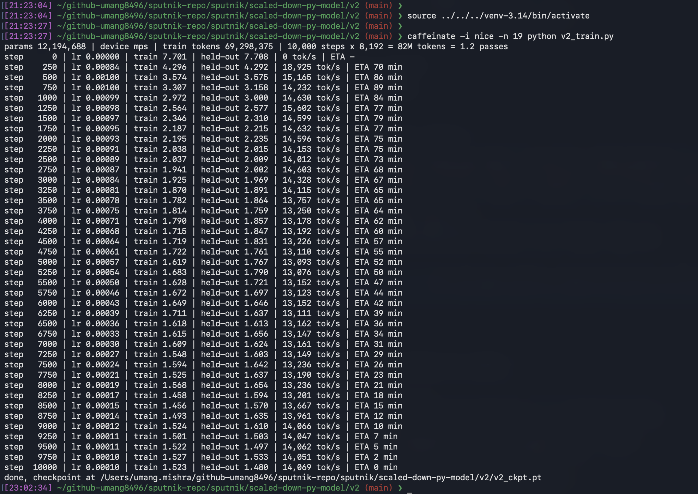

<!-- markdownlint-disable MD033 -->
<!-- markdownlint-disable MD036 -->
<!-- markdownlint-disable MD040 -->
<!-- markdownlint-disable MD060 -->

# Scaled-Down Python Model

A GPT-style language model built **from scratch** and trained to write Python code.
It has the same pieces as a production model, at a tiny scale: a data pipeline, a BPE tokenizer, a transformer with attention and RoPE, a training loop, sampling, checkpoints, and a serving endpoint.
The goal is understanding, not quality: every step is shown working before the next one is built.

The project has two versions:

- **v1** (0.9 M parameters): the teaching version. Every component is built and inspected in one notebook, then trained in about a minute.
- **v2** (12.2 M parameters): the same architecture scaled up, with on-disk data, a model module, and a resumable training script that runs for well over an hour.

```
.py source files ─► clean ─► BPE tokenizer ─► transformer ─► train ─► checkpoint ─► notebook / HTTP API
```

## Versions at a glance

| | v1 | v2 |
|---|---|---|
| Data | Python stdlib: 423 files, 8.4 MB | stdlib + venv packages: 19,265 files, 233 MB |
| Held-out split | Last 10% of one token stream | Random 10% of whole files |
| Tokenizer | BPE, 512 tokens, 2.15 chars/token | BPE, 2,048 tokens, 3.03 chars/token |
| Model | 4 layers, width 128, 4 heads | 6 layers, width 384, 6 heads |
| Parameters | 918,656 | 12,194,688 |
| Context | 256 tokens | 512 tokens |
| Training | 2,000 steps (~8 M tokens) in a notebook cell, ~70 s | 10,000 steps (~82 M tokens) in a terminal script, ~1 h 40 min |
| Held-out loss | 2.34 | 1.48 |
| **Bits per character** | **≈ 1.57** | **≈ 0.70** |
| Extras | Inference notebook, HTTP server | Resumable training, saved tokenizer |

Losses aren't directly comparable across versions because the tokenizers differ. Bits per character is the fairer measure, but the held-out sets also differ, so treat it as approximate.

## Layout

```text
scaled-down-py-model/
  README.md
  v1/                         teaching version
    v1_builder.ipynb          build + train the model, step by step (13 sections)
    v1_inference.ipynb        load the checkpoint and use it (no retraining)
    serve.py                  HTTP server: POST /generate
    mini_llm_v1.pt            checkpoint: weights + config + tokenizer (~4 MB)
    corpus.txt                cleaned training text (~8 MB, regenerated by the builder)
  v2/                         scaled-up version
    v2_builder.ipynb          data, tokenizer, model, training setup, results (11 sections)
    v2_model.py               MiniLLM architecture (written by the notebook)
    v2_train.py               resumable training script (written by the notebook)
    v2_train_log.txt          log of the training run
    v2_ckpt.pt                checkpoint: weights + optimizer state + step + config (~146 MB)
    v2_data/
      train.bin, val.bin      token IDs as uint16 (~139 MB + ~15 MB)
      tokenizer.pkl           merges, vocab, split regex, EOF ID
    image.png                 screenshot of the training run
```

Each version folder is self-contained, and its files reference each other by relative paths.

## Quick start

Requires Python 3.14 and PyTorch (developed on 2.15); v2 also needs NumPy.
Both versions use the Apple-silicon GPU (`mps`) when it's available, and v2's benchmark cell requires it.
The repo's virtual environment lives at `sputnik-repo/venv-3.14`.

**v1**

```bash
cd sputnik/scaled-down-py-model/v1

# 1. (optional) rebuild: run v1_builder.ipynb top to bottom
#    -> writes corpus.txt and mini_llm_v1.pt (~2 min on mps)
# 2. explore: run v1_inference.ipynb
# 3. serve:
../../../venv-3.14/bin/python serve.py            # http://127.0.0.1:8000
```

**v2**

```bash
cd sputnik/scaled-down-py-model/v2
source ../../../venv-3.14/bin/activate

# 1. run v2_builder.ipynb sections 1-8
#    -> writes v2_data/, v2_model.py and v2_train.py
# 2. train in a terminal (Ctrl+C to stop; the same command resumes):
caffeinate -i nice -n 19 python v2_train.py       # 10,000 steps, ~1 h 40 min
# 3. run sections 10-11 of the notebook to load v2_ckpt.pt and generate
```

Run each notebook with its own folder as the working directory, since they read and write files there.

## The notebooks

**`v1_builder.ipynb`** builds the model one concept at a time. Each section explains the idea, runs the code, and records the output.

| # | Section | # | Section |
|---|---|---|---|
| 1 | Sizing the model (parameter count by hand) | 8 | Attention, the "Mix" step (Q/K/V, heads, RoPE, causal mask) |
| 2 | Collecting the stdlib `.py` files | 9 | Feed-forward, the "Refine" step |
| 3 | Cleaning: UTF-8, de-duplication, size filter, normalisation | 10 | Assembling `MiniLLM` |
| 4 | Training a byte-level BPE tokenizer | 11 | One learning step: loss → backprop → AdamW |
| 5 | Encoding the corpus + train / held-out split | 12 | Training: warm-up + cosine schedule, gradient clipping |
| 6 | Batching for next-token prediction | 13 | Generating code |
| 7 | Embedding: IDs → vectors | | |

**`v1_inference.ipynb`** loads `mini_llm_v1.pt`, rebuilds the tokenizer and model, and checks the reload against the held-out loss. It then shows the model's top next-token predictions, generates code, compares temperatures, and ends with a "try your own prompt" cell.

**`v2_builder.ipynb`** covers what changes at scale. It assumes v1 for the model internals.

| # | Section | # | Section |
|---|---|---|---|
| 1 | Sizing the model + the 20-tokens-per-parameter data budget | 7 | Smoke test and speed benchmark |
| 2 | Collecting the stdlib + `site-packages` files | 8 | Writing the resumable `v2_train.py` |
| 3 | Cleaning (adds a long-line filter) + file-level held-out split | 9 | The training run (terminal log) |
| 4 | A faster BPE trainer with incremental pair counts, 2,048 tokens | 10 | Loading the checkpoint and generating |
| 5 | Encoding to `uint16` binaries + `tokenizer.pkl` | 11 | Fixing the prompt (whitespace gotcha) |
| 6 | Writing the model module `v2_model.py` | | |

## Results

### v1

| Model | Loss | Perplexity | Bits / char |
|---|---|---|---|
| Untrained | 6.43 | 617 | 4.30 |
| **Trained** | **2.36** | **10.6** | **1.58** |

Measured over the full held-out set in `v1_inference.ipynb`.
The output has Python's *shape* (indentation, `def`/`class`, `self.` attributes, docstrings), but its *meaning* is nonsense and it won't run:

```python
class Stack:
    def push(self, item):
        if pos ===1:
            raise ValueError("protocol; not shared file")

    def read_no(self):
        """Add in the list connection to a num
```

### v2

| Model | Loss | Perplexity | Bits / char |
|---|---|---|---|
| Untrained (step 0) | 7.71 | ~2,200 | 3.67 |
| **Trained (step 10,000)** | **1.48** | **4.4** | **0.70** |

These are estimates from 20 random held-out batches, taken from the training log.
Train and held-out loss stayed close throughout (whole files held out, 1.2 passes over the data), so there's no sign of overfitting.



The output is much more convincing than v1's. It uses type hints, f-strings, `:param` docstrings and sensible method structure, though the logic is still wrong (here `__hash__` returns a string):

```python
    def __init__(self, value: str) -> None:
        self.value = value

    def __repr__(self) -> str:
        return f"<repr(value={self!r})>"

    def __hash__(self) -> int:
        return self.value
```

It still falls into **repetition loops**, repeating the same function or docstring line many times.

## HTTP API (`v1/serve.py`)

The server uses the standard library plus PyTorch. It loads the **v1** checkpoint once, listens on `127.0.0.1:8000` by default, and runs one generation at a time.
It can't serve v2 as is, because the v2 checkpoint keeps its tokenizer in a separate `tokenizer.pkl`.

| Method | Path | Returns |
|---|---|---|
| `GET` | `/` | Usage help |
| `GET` | `/health` | Model info: params, device, config, defaults |
| `POST` | `/generate` | A completion (JSON, or plain text) |

**`POST /generate` body** (all fields optional)

| Field | Type | Range | Default | Meaning |
|---|---|---|---|---|
| `prompt` | string | ≤ 4000 chars | `""` | Text to continue; empty = start a new file |
| `max_new` | int | 1–1000 | 150 | Tokens to generate |
| `temperature` | number | 0–2 | 0.8 | 0 = greedy, < 1 = safer, > 1 = wilder |
| `top_k` | int | 0–512 | 40 | Sample only from the k most likely tokens (0 = all) |
| `seed` | int | ≥ 0 | random | Makes a sample repeatable |
| `format` | string | `json` / `text` | `json` | Reply format |

```bash
curl -X POST http://127.0.0.1:8000/generate \
     -H 'Content-Type: application/json' \
     -d '{"prompt": "def read_config(path):", "max_new": 80, "seed": 1}'
```

```json
{
  "prompt": "def read_config(path):",
  "completion": "\n        \"\"\"Repath = repath.join()\n        exp = ''.join(path)\n ...",
  "text": "def read_config(path):\n        \"\"\"Repath = ...",
  "tokens": { "prompt": 11, "generated": 80, "stopped": "max_new" },
  "settings": { "max_new": 80, "temperature": 0.8, "top_k": 40, "seed": 1 },
  "elapsed_ms": 150,
  "tokens_per_s": 530.0,
  "warnings": []
}
```

Invalid input returns `400` with an `{"error": ...}` message (unknown fields, wrong types, out-of-range values). `GET /generate` returns `405`.
Options: `--host`, `--port`, `--ckpt`, `--device {auto,mps,cuda,cpu}`. The server has no authentication, so only bind to `0.0.0.0` on a network you trust.

## Gotchas

**Both versions**

- **End prompts at a non-space character, such as the `:`.** The tokenizer attaches whitespace to whatever *follows* it. A prompt ending in `"\n"` leaves a lone newline token, which in training only came before column-0 code, so the function body never gets indented. A trailing space has a similar effect. `v1_inference.ipynb` (section 5) and `v2_builder.ipynb` (section 11) show this, and `serve.py` adds a warning when it happens.

**v1**

- **The checkpoint stores numbers, not code.** `mini_llm_v1.pt` holds the weights, config, and BPE tables, but not the model classes or the split regex. Those are copied in `v1_builder.ipynb`, `v1_inference.ipynb` and `serve.py`, so all three must stay in sync. (v2 fixes this with `v2_model.py` and `tokenizer.pkl`.)
- **The config changes partway through the builder.** Section 1 sets `seq=128, batch=32`, but section 7 changes it to `256 / 16`, and training uses (and the checkpoint stores) the latter.
- **The held-out set is the last 10% of tokens in file-search order**, not a random sample of files. (v2 fixes this.)

**v2**

- **`v2_train.py` has its own copy of `cfg`.** Keep it in sync with section 1 of the notebook.
- **The step count sets the cosine schedule.** Resume with the same step count you started with.
- **The data depends on the installed packages.** The corpus comes from the venv's `site-packages`, so another machine produces different data.
- **The benchmark cell (section 7) needs `mps`.** It calls `torch.mps.synchronize()` unconditionally.
- **Some files are large.** `v2_ckpt.pt` (~146 MB, two-thirds of it optimizer state) and `v2_data/train.bin` (~139 MB) exceed GitHub's 100 MB per-file limit. Ignore them in git or use Git LFS; the notebook and training script regenerate them.

## Ideas for v3

Done in v2: scaling up, file-level held-out split, a model module, and a saved tokenizer.

- **More data**: 69 M training tokens is about 28% of the 20-tokens-per-parameter target.
- **Fix repetition**: add a repetition penalty or nucleus (top-p) sampling.
- **Inference for v2**: a `v2_inference.ipynb`, and a `serve.py` that imports `v2_model.py` and loads `tokenizer.pkl`.
- **Precise evaluation**: measure held-out loss over all of `val.bin`; plot loss curves; check how many samples pass `ast.parse`.
- **Modern extras**: weight tying, SwiGLU, a KV-cache for faster generation, mixed precision.
